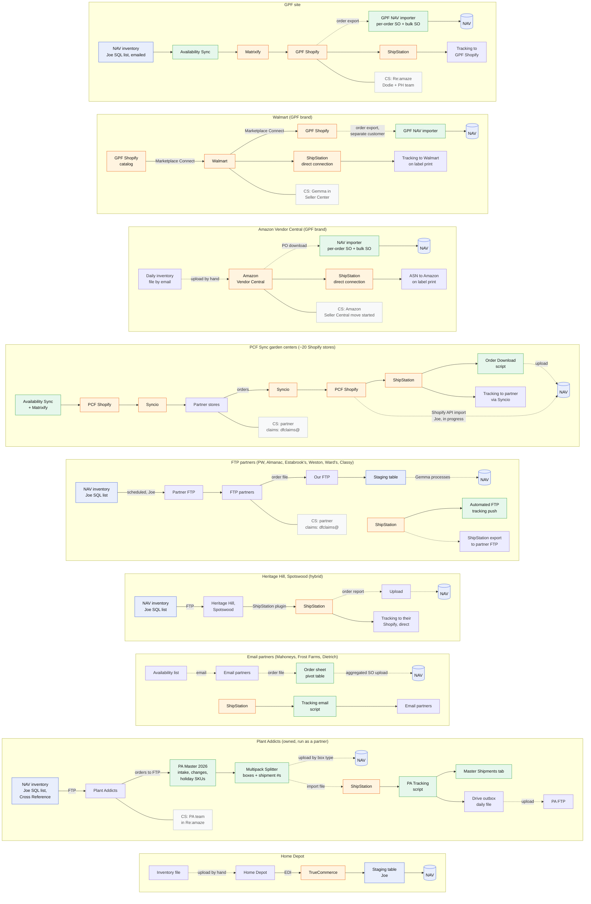
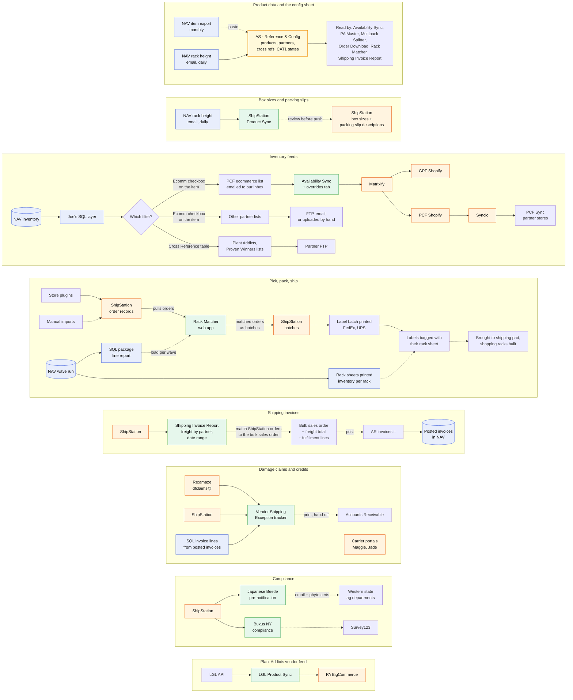
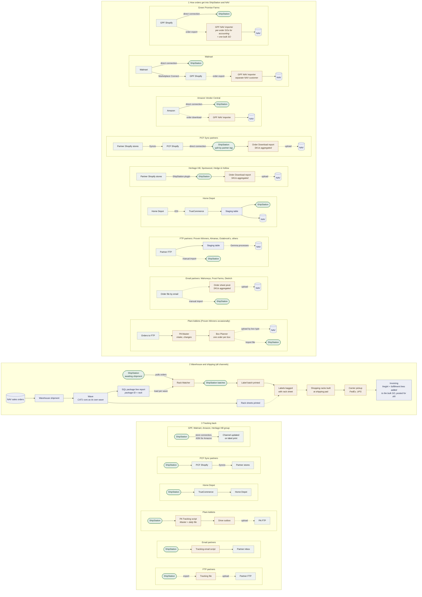
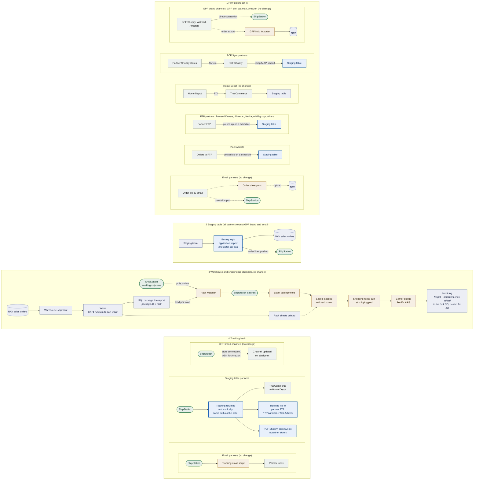

# Pride's Corner Farms: Ecommerce Workflow Charts

Diagrams supporting the Ecommerce Tools and Workflows summary.

**Key:** solid arrows are automated; dotted arrows are manual steps or handoffs.

1. [Order flow by channel](#order-flow-by-channel)
2. [Shared systems and support tools](#shared-systems-and-support-tools)
3. [Order flow: current state](#order-flow-current-state)
4. [Order flow: target state](#order-flow-target-state)

PNG versions are in the [images](images) folder.

## Order flow by channel

How each channel connects: inventory out, orders in, into NAV, shipping and tracking back.

## Shared systems and support tools

Product data, inventory feeds, pick/pack/ship, invoicing, claims and compliance.

## Order flow: current state

## Order flow: target state

Bold blue boxes are new or changed from today.

